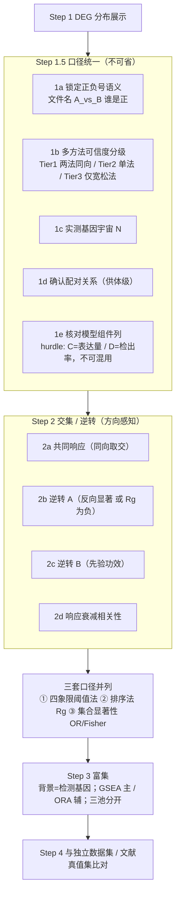

# 多对比 DEG 整合（交集 / 逆转 / 共享响应）

## 何时使用

用户**已经算好** DEG，问的是"接下来怎么研究"或直接点名要交集 —— 不是问怎么算 DEG（那走 `deg-analysis`）。

触发信号：

- 「我这么多 DEG 该怎么往下做」
- 「找重合的 DEG」「运动共同的 DEG」
- 「运动**逆转**衰老 / 逆转糖尿病的重合基因」
- 「哪些是某条件特异的」
- 要出 UpSet / Venn「重合」图

**典型设计**：多条件（Young / Old / Old+Disease）× 干预（Pre / Post）、**配对供体** ——
这类设计里"条件效应"与"干预效应"是两个可比的向量，所以能做逆转分析，也必须按下面的铁律做。


---

## 零、拿到陌生 DEG 工作簿：先做结构侦察（只读展示任务）

用户丢一张**已算好**的 DEG 工作簿（xlsx / 多 sheet）说「看看这表里有什么」「给我展示这个数据有什么信息」时，
**不是**让你重算 DEG，也不是让你算交集 —— 是**只读侦察 + 对话内就绪报告**。

**先跑探针（⛔ 硬规则：禁止手写侦察代码）**：`scripts/merged_deg_workbook_recon.py <工作簿.xlsx>`
> 2026-10-23 复现教训：手写 pandas 侦察「看起来跑通了」，却漏掉清单第 6 步 **C/D 符号一致率** →
> 报告里只能写「`_D` 口径待确认」，方向性结论整段悬空、交出去的是半成品。探针脚本是 7 步的固化实现，
> **先跑它再动嘴**；手写只允许补探针没覆盖的字段（如 `method` / `nRUV_used` 的唯一值）。
→ 一次拿到：sheet/列/元信息唯一值、每 sheet 规模与显著性（C 与 D 两套）、**CvsD 符号一致率**、
跨亚群集合交集、TOP10，并自动排掉下面三个算术陷阱。

**必查的五个点**（任一没查就下结论 = 返工）：

| # | 查什么 | 事实证明过的后果 |
|---|---|---|
| 1 | **汇总表 = 各亚群拼接？** 核对时**先排除汇总表**再求和 | 把 `ALL_merged` 自己算进"各 sheet 之和"→ 打印出双倍（63,516→127,032）并误判"不相等" |
| 2 | `rows` vs `gene.nunique()` | 63,516 行只对应 8,383 基因 → 各亚群基因集不同，行数 ≠ 基因数 |
| 3 | `n_cells` 是否**常量列** | 每亚群一个值 = 细胞类型总细胞数，**不是**分组细胞数 |
| 4 | **`coef` vs `coef_D` 符号一致率** | 全表 0.363、亚群 0.15~0.65、关键基因 22.1% 反号 → 口径没确认，上下调结论可能整篇反过来 |
| 5 | 跨 sheet 交集用**原始基因集** | 行数累加出的"共同基因"是错的 |

第 4 点是本类**最贵的**坑：hurdle 模型同时导出 C（表达量）与 D（检出率）组件，`direction` 列往往
**只约束 C**（本例 `"OD_Pre > O_Pre (coef>0)"`），而按 D 排序会得到相反的全局方向。
→ 把一致率与两套极差并列报出来，**问用户确认报告口径**；确认前禁止写方向性结论。

**交付形态**：一句话定性 → 结构表 → 每 sheet 规模/显著性表 → 信号读数表（跨亚群**同向**基因 + 显著亚群数）
→ 疑点 callout → 关键过程一句话 → 2–3 条下一步选项。
⛔ 不开 task_plan、不辩论、不生成报告文件（仅落一个复用探针脚本；`record_run` + `rail_review(post)` 各一次即可）。
⚠️ 缺项也要说明：`PAX7/MYOD1/CDKN2A/TFAM` 这类不在表内多为基因过滤所致 → **"不在表里"≠"无变化"**。

> 完整清单、三个算术陷阱的实测数字、本例（10 细胞类型 × 单对比 bayesglm+RUV10）读数与报告骨架 →
> `references/merged-deg-workbook-recon.md`

---

## 先给路线：三步是连续的，但**中间必须插一步**

用户的直觉通常是「① 展示分布 → ② 找重合 → ③ 做富集」。顺序对，**但 ① 和 ② 之间必须插"口径统一"**，
否则 ② 的数字不可信。



> **开工第一件事**：跑 `scripts/deg_table_power_probe.py <DEG目录>`（宽表直接跑、长表加 `--split-by contrast,celltype`）
> —— 一次拿到每张表的形态、每个对比的检出功效、阈值是否在起作用、以及每对集合的
> 「真实交集 vs 随机期望 E / OR / Jaccard」四张表。**这四个数出来之后再决定做不做交集**，
> 不要先算完再回头怀疑。

**1a 是本类分析最昂贵的错误源**：`A_vs_B` 这种文件名**不告诉你正负号是谁减谁**。
方向锁定错 → 所有"逆转"结论**整体反过来**。开工第一步就是把它钉死，不要默认。

---

## 六条铁律

### 1. 交集必须方向感知 —— 基因名交集天然一半是假阳性

| 象限 | 判据 | 生物学含义 |
|---|---|---|
| 同向（concordant） | 条件↑ 且 干预↑ | 干预**加剧**了条件特征 —— **不是逆转** |
| **反向（discordant）** | 条件↑ 且 干预↓ | 干预把方向扭回来 ← **这才是逆转** |
| 同向 | 条件↓ 且 干预↓ | 同上，加重下调 |
| 反向 | 条件↓ 且 干预↑ | 逆转（下调侧） |

- 任何"重合基因"表**必须按象限分列**；把四格合并成一个数 = 结论作废
- **一边显著、另一边不显著 ≠ 阴性** —— 多半是功效不足（见铁律 3）

### 2. 原始交集数必须先减随机期望

```
E[|A ∩ B|] = |A| × |B| / N        N = 实际检测到的基因数（不是全基因组）
```

实测：某条件集 16,535 基因、N ≈ 27,015、另一个集合 231 基因 → `E ≈ 141`，**占后者 61%**。
直接数交集 = 大集合把六成基因"吸"进来，纯算术。

| 该报 | 不该只报 |
|---|---|
| Odds ratio、Fisher 精确检验（背景 = N） | 原始交集个数 |
| Jaccard index | Venn 图里的数字（无基线） |
| 交集数 **与 E 并排** | "重合 300 个基因" |

**阈值无关的替代（与阈值法并列做）**：`s = sign(coef) × (−log10 p)`（或 `coef/SE` 的 z）
→ 单基因逆转分 `Rg = s_条件 × s_干预`（负 = 反向）；全局 `cor(s_条件, s_干预)` 为负 = 整体反向。
好处：不依赖 0.2/0.25 这类人为划线，效应温和但真实的基因不会被切掉。

### 3. 交集前先出「各对比检出数」表

实测（同一批数据、老方法 pseudobulk dreamlet、`|logFC|>0.25 & FDR<0.05`）：

| 对比 | Aging | Ex_Old | Ex_Young | Ex_DM | DM |
|---|---|---|---|---|---|
| 显著行数 | **29,542** | 1,246 | **22** | **4** | **1** |

→ `DM`=1、`Ex_DM`=4：**"干预逆转该疾病"这条线在这个方法上不存在**，交集数学上必为 0。
**同一批数据里不同对比的可分析性差异极大**，不能假定"有 DEG 就能做交集"。

- 任一边 < ~50 个基因 → 该交集**先别做**，换另一套 DEG 或明确声明局限，**不要给出数字**
- 检出数差异 >10× 的组合 → 必须做铁律 2 的期望校正

### 4. 诊断「阈值到底在不起作用」

把该方法 **|effect| 的中位数** 与阈值比：

| 方法 | \|logFC\| 中位数 | 阈值 0.25 的实际效果 |
|---|---|---|
| 老方法（dreamlet pseudobulk） | **0.3475** | 29,550 → **29,542**，只砍 8 行 → **等于不设防** |
| 新方法（细胞级 glmer+RUV） | 远低于 0.25 | 0.20→0.25 砍掉 11,111 行 |

**"0.25 砍掉了多少基因"这句话不能跨方法套用** —— 阈值作用完全取决于该方法自身效应量分布。
读 `|coef|` 分位数：中位数 > 阈值 → 别拿它当"我们做了严格过滤"的证据。

### 5. 推断单位必须与设计一致

- 配对设计（同供体 Pre/Post）→ 逆转分析必须在**供体级**做
- 细胞级 p 值做**条件间**比较 = **伪重复**（pseudoreplication）
- 实测：ICC = 0.418 → 设计效应 ≈ 2984 → 有效 n = 57；精度上限由**供体数**决定，
  **加细胞数不增加信息**（细胞级假阳性率随深度 25%→93.5%，供体级稳定 3.5–9.0%）
- 汇报必须写清用的是细胞级还是供体级 p 值

### 6. 富集的三条硬约束

1. **背景 = 实际检测基因**（非全基因组）—— 否则线粒体/核糖体等超大基因家族淹没所有通路、FDR 失真
2. **小交集以 GSEA 为主、ORA 只做辅**（GSEA 只用排序、不用阈值，对"交集太小"稳得多）；ORA 要带 OR
3. **绝不在 >1 万基因的超大集上做 ORA** —— 什么通路都会"显著"，是纯噪声；超大集只适合 GSEA

**三池分开富集**：共同响应 / 逆转 A / 逆转 B —— 分栏对照才能看出通路分工。

---

## 七、按「基因家族 / 基因名」出亚群频次表（用户常点的另一类整合动作）

用户会跳过交集直接点名一个家族问：**「某家族基因在各比较组分别出现在多少个亚群」**
（本例：HSP；用户原话「HSPA9 出现频率 5 次」）。这是**描述性汇总**，不重算 DEG，但配方与措辞边界固定。

### 配方（5 步）
1. **先查重复**：`df.duplicated(subset=['gene','celltype']).sum()`
   - = 0（本例实测 0）→「频次」等价于**显著亚群个数**，无需去重
   - > 0 → 必须先定去重口径，否则频次虚高
   - ⚠️ 亚群列名不一定是 `subcluster`，本项目是 **`celltype`** —— 先打印列名再写代码
2. **每比较组一个 sheet**：`gene / n_subclusters(频次) / subclusters(名单) / n_up_sub / n_down_sub / regulation / max_abs_coef / min_fdr`，按频次降序
3. **另加跨组矩阵 sheet**：基因 × 比较组频次（`<sheet>_n_subcluster` + `n_comparisons_sig`）—— 一眼看出跨组基因
4. **与逆转/交集表联动**：同家族在 785 / 27 / 13 / 5 / 9 这些集合里各命中谁，单独出 sheet（沿用铁律 2 的期望基线口径）
5. **必须出一张频率热图**（`np.ma.masked_where(M == 0, M)` 把 0 遮成浅灰、格内标数字、**轴标签纯英文**）——
   纯表格任务不出图，`rail_review(post)` 会以 `figure_count=0` 判不通过，
   见 `platform-execution-pitfalls` → `references/post-review-figure-gate.md`

### ⚠️ 铁律 7：按「命名前缀」筛家族会系统性漏检功能同家族成员
**实测**：用户要「HSP 开头的基因」→ 主口径 `^HSP` 得 **11 个**（衰老表）；
补扩展口径 `^HSP|^DNAJ[ABC]|^HSPH1` → **36 个**。
**根因**：**功能家族 ≠ 命名前缀**。HSP40 家族的官方基因名是 DNAJA/DNAJB/DNAJC（J-domain proteins），
根本不带 HSP；HSPH1 同理；另有读穿转录本命名（HSPE1-MOB4 这类须保留并单独标注）。
**做法（三步，别只做一步）**：
1. 主表**严格按用户字面口径**出（要什么给什么，不擅自改口径）
2. **同时**跑扩展口径敏感性表，量化「新增哪些基因、交集/逆转结论是否改变」
3. 结论措辞限定「**在本口径内**」，不得写家族整体结论

> 本例两种口径下「逆转衰老 ∩ 逆转糖尿病 ∩ 锻炼共同」**均为空集** → 结论与口径无关，可按主口径汇报。

### 措辞边界（必须写进图注/表注）
| 边界 | 写法 |
|---|---|
| 频次 ≠ 效应量 | 「亚群共享频率」= 显著亚群**计数**，受各亚群细胞数/检出率/检验功效影响，高频 ≠ 强效应 |
| 空交集 / 0 命中 | 「本套 DEG 表中未观察到共现」**并附各表规模**（本例 DM 311 行 / Y_EX 115 行 → 0 命中 ≠ 生物学无变化） |
| 全局偏移表 | 某对比 Up 巨多/Down 极少且效应量中位数贴合阈值（本例 Aging：Up 22,709 / Down 469、coef 中位 0.301 vs 阈值 0.25）→ 该表「全 Up」降级为「本口径内描述、待独立验证」，禁用「整体上调」「核心基因」 |
| **保留率未并报** | 任何"某对比响应最强 / 最弱"的说法必须并报 **保留率 = 过滤后行数 / 该对比 FDR<0.05 行数**（本例 Aging 38.8% vs DM 0.85%）——否则把"可检出性差异"读成"生物学强度差异" |
| **措辞降调三件套** | "主导"→"本过滤条件下规模最大"；"引起"→"观察到"；"微弱 / 无效应"→"可检出信号少、功效受限"（要升格须补 MDES/等效检验、阈值敏感性、独立验证） |
| **共享项写进设计说明** | 两对比共用同一条件组（符号相反）时，反号交集必须写明"共享项可由代数解释"（见第八节），并列出对照对（无共享项的对比）的 OR 作参照 |

> 完整配方与本例 HSP 案例（源表结构、17-sheet 输出布局、脚本要点、辩论裁决）→

---

## 八、共享条件项 ⇒ 反号交集天然富集（**代数伪相关**，2026-10-23 实测）

当两个对比**共用同一个条件组**且符号相反时，反号（逆转）交集**在数学上必然被抬高**：

| 对比 | 定义 | 共享项 |
|---|---|---|
| Aging | O_Pre − Y_Pre | O_Pre（**+**） |
| Ex_Old | O_Post − O_Pre | O_Pre（**−**） |

→ 某基因的 O_Pre 水平越高：Aging coef ↑ 且 Ex_Old coef ↓ ⇒ **`Aging↑ ∩ Ex_Old↓` 天然富集**。
实测（cell-level RUV-MAST 过滤表）：观察 **785** vs 随机期望 **630**（N=9,581），OR=2.93, p=3e-35
—— 量级与"共享项代数结构"的预期一致，**不能作为"运动逆转衰老"的证据**。

**两条判据（看出是代数还是生物学）**：
- 看**宏观镜像**：Aging 98% up ↔ Ex_Old 86% down，方向近饱和且互为相反 → 先怀疑共享项；
- 看**对照对**：只有共享项那一对显著（本例 Aging∩DM OR=1.25 n.s.、Aging∩Ex-Young OR=1.42 n.s.）
  → 信号更可能是代数而非生物学。

**允许写**："在本设计下两者交集富集（785，期望 630，OR=2.93），但 Ex_Old 与 Aging 共享 O_Pre 项且符号相反，
该富集可由代数结构解释；除非独立设计或非共享参数化仍复现，不作因果/逆转解读。"
**禁止**：因果 / 逆转表述（"运动逆转衰老" "向年轻模式靠拢"）。

### 8b. 结论降调三件套（辩论裁决 modify 的落点）

| 原稿 | 降调后 |
|---|---|
| "Aging 是最主导的重塑" | "**本过滤条件下 DEG 规模最大**（附行数/基因数/保留率）" |
| "运动引起全局重塑" | "**观察到**……（附亚群集中度），不宜泛化、不作因果" |
| "某条件效应微弱/无效应" | "**可检出信号少、功效受限**"（补 MDES/等效检验后才可升格） |

**保留率必须并报**：任何"某对比响应最强/最弱"的说法，都要并报 `保留率 = 过滤后行数 / FDR<0.05 行数`
（本例 Aging 38.8% vs DM 0.85%）——否则把"可检出性差异"读成"生物学强度差异"。

> 完整实测数字、降调表、升格条件、hurdle 组件列（C/D）口径陷阱 →
> `references/shared-term-pseudo-correlation.md`

---

## 判据表模板（直接照用）

| 用户问题 | 基因集运算 | 主判据 | 必须附带 |
|---|---|---|---|
| 干预共同响应 | `E_1 ∩ E_2 ∩ E_3`，**同向取交** | 三集合交集 + 多集合显著性 | Jaccard、每对 OR、UpSet 图 |
| 干预逆转条件 A | `A` 与 `E_A` **反向显著**；或 `Rg` 为负 | 反向基因数 **vs 期望** `\|A\|×\|E_A\|/N`；全局 `cor` 为负 | 供体级配对检验；每套 DEG 各做一遍 |
| 干预逆转条件 B | 同上换 B | 同上 | ⚠️ 先确认功效（铁律 3），无功效则不下结论 |
| （建议加做）响应是否衰减 | `cor(E_1, E_2, E_3)` 跨基因 | 高相关 = 响应保留；条件组显著低 = 衰减 | 常比"逆转"更独特（如合成代谢抵抗） |

**"响应是否衰减"这一条要主动加**：多条件 × 同干预、配对、同批次的设计能做到，
而绝大多数公开数据做不到 —— 是这类设计最不容易被别人做掉的一条线。

---

## 出图建议

| 图 | 为什么 |
|---|---|
| **2×2 象限散点**（x = 条件效应，y = 干预效应） | **一张图直接读逆转/加剧/无关**，信息量远大于交集数；标注各象限基因数 |
| **UpSet**（≥4 集合） | 远胜 Venn：支持多集合、精确交集、可排序；Venn 超 3 集合就不可读 |
| 逆转基因**供体级热图**（行 = 基因，列 = 供体 × Pre/Post） | 把"逆转"落到个体层面，审稿人最想看 |
| 三个富集池**并列条/气泡** | 共同响应 / 逆转 A / 逆转 B 分栏 |

---

## 自查清单（交结论前逐条过）

- [ ] 把同向重合当成了逆转（**最常见**）
- [ ] 报了原始交集数，没有随机期望 / OR 基线
- [ ] 在检出数是个位数的对比上做交集，然后解释"没有重叠说明无关"
- [ ] 用细胞级 p 值做条件间比较（伪重复）
- [ ] 富集背景用了全基因组而不是检测基因
- [ ] 在超大 DEG 集（>1 万）上做 ORA
- [ ] 文件名 `A_vs_B` 的正负号没锁定就直接算方向
- [ ] 引用了 `SuperExactTest` / `RobustRankAggreg` 的 PMID 却没核实原文（**检索未命中其原始方法学文献，不许凭记忆编**）
- [ ] 按**命名前缀**筛家族，没跑扩展口径就说「XX 家族整体…」（HSP40 家族 = DNAJ 前缀，`^HSP` 抓不到 → 铁律 7）
- [ ] 频次/计数表没写「频次 ≠ 效应量、受亚群细胞数与功效影响」
- [ ] 交集/共享基因结论没给**阈值轨迹**（2026-10-23 实测：五对比共同基因 4,073→399→45→1→0，「唯一 PDK4」是阈值产物；反号交集 785 在相邻档间 5,790↔21 剧变）→ 共享集合写「**本主阈值下未检出**」，不写「不存在」；单点计数的交集结构不得称为「核心」
- [ ] 两个对比**共享同一条件组**（符号相反）时，把反号交集的富集当成生物学"逆转"（**代数伪相关** → 第八节）
- [ ] 结论用了"主导 / 逆转 / 微弱"级措辞却没降调、没并报保留率（措辞强度 ≠ 证据强度）
- [ ] 表里有 hurdle 组件列（`coef_D/p_D/fdr_D`）时，没写清过滤/排序用的是 C（表达量）还是 D（检出率）
- [ ] 纯汇总任务忘了出图 → `rail_review(post)` 以 `figure_count=0` 判不通过
- [ ] 核实「汇总表 = 各亚群拼接」时把汇总表自己也算进求和（双倍 → 误判不相等）
- [ ] 把行数当基因数（各亚群基因集不同）、把常量列 `n_cells` 当分组细胞数
- [ ] 有 `coef_D` 时没查 C/D **符号一致率**就写上调/下调结论（本例一致率仅 0.363，问清口径前禁止下方向结论）
- [ ] 「某基因不在表里」被当成「无变化」（多为表达阈值/过滤所致，须说明）

---

## 与其他 skill 的分工

| 任务 | 走哪 |
|---|---|
| 从表达矩阵**算** DEG | `deg-analysis` / `deg-mixed-design` |
| 已算好的多套 DEG **整合**（本 skill） | 本 skill |
| DEG → GO/KEGG/GSEA 结论的**定稿前验证** | `enrichment-conclusion-validation` |
| 富集本身怎么跑 | `functional-enrichment` |

> 本 skill 只管"交集/逆转/共享"这一类整合动作与其判据；不重算 DEG。

## 参考来源

  （源表结构、17-sheet 输出布局、命名前缀陷阱实测 11→36、措辞边界、辩论裁决）
- `scripts/deg_table_power_probe.py` —— **开工体检器**：读 csv/xlsx/长表，输出 POWER（各对比检出数）/
  THRESHOLD（阈值是否不设防）/ OVERLAP（obs vs E / OR / Jaccard）三张表 + VERDICT
- `references/shared-term-pseudo-correlation.md` —— **共享条件项的代数伪相关**（Aging/Ex_Old 共享 O_Pre：
  实测 785 vs 期望 630）+ 结论降调表（辩论裁决 modify）+ hurdle 组件列（C/D）口径陷阱
- `references/merged-deg-workbook-recon.md` —— **陌生 DEG 工作簿结构侦察**（第零节配套）：7 步清单、
  三个算术陷阱实测数字、C/D 符号一致率口径陷阱、本例读数、对话内报告骨架
- `scripts/merged_deg_workbook_recon.py` —— **陌生 DEG 工作簿探针**：结构/规模/显著性/CvsD 一致率/
  跨亚群交集/TOP10 一次出，自带汇总表排除与拼接一致性断言
- 文献依据（本类分析通行的"干预逆转"范式）见该 reference 的文献小节