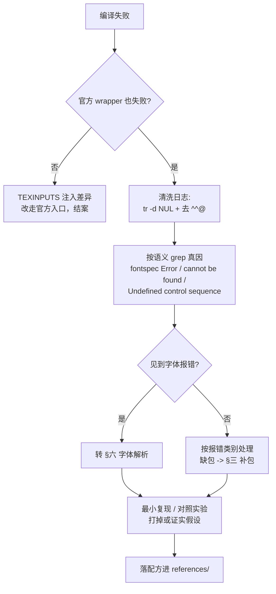
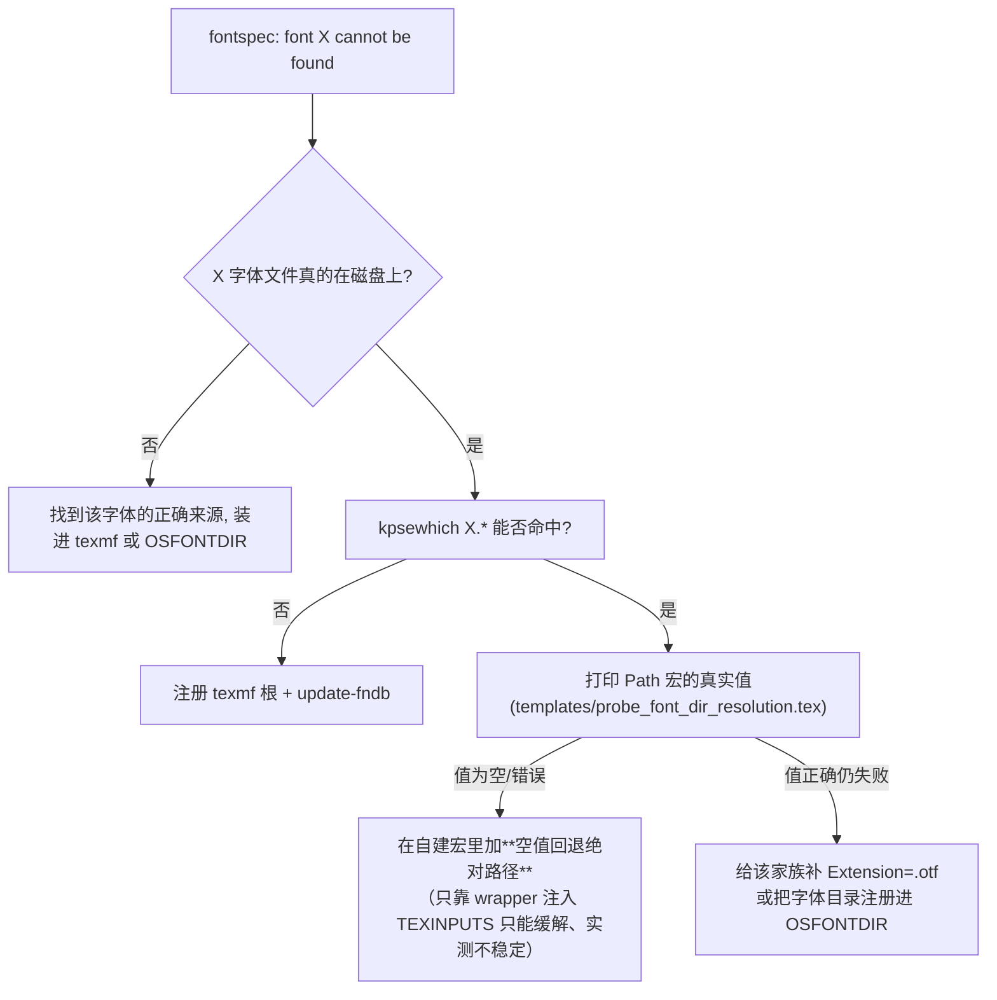

# LaTeX 编译链：安装、包/字体装配与编译失败排障

**定位**：这是**工具链层**的技能——解决「LaTeX 环境本身不工作」。文档内容写什么、用哪个学校模板，不在这里（见 REF §1 的分工表）。

**根原则（本 skill 唯一最重要的一条）**：
> **先拿证据，再提假设。**验证过的数字/报错原文/文件清单先落地，再谈机理；**任何"我怀疑是 X"都必须用最小复现或对照实验打掉或证实**，否则不许写进结论。
> 本 skill 的 `references/cv01-fontawesome-case.md` 就是反面教材：两条听上去很合理的假设（hyperref 书签展开、fontawesome v4/v5 混用）都被实验否证，而真因（fontspec 找不到字体）其实**一直明写在日志第 4322 行**。

---

## 一、触发边界

### ✅ 该用
| 用户说 / 现象 | 走本 skill 的哪一节 |
|---|---|
| 装 TeX / 装 MiKTeX / TeX Live / 没有 xelatex | §二 装工具链 |
| 编译报缺宏包（`tabu.sty not found`） | §三 补包 + §五 排障 |
| `fontspec Error: The font "X" cannot be found` | §六 字体解析 |
| `wrong@fontshape` 递归 / `TeX capacity exceeded [pool size]` | §五 排障（先查字体） |
| 把自建 `.sty`/`.cls`/字体装成全局可用 | §三 |
| 日志巨大、被 NUL(`^^@`) 灌满、读不动 | §五 + `scripts/tex_log_root_cause.sh` |
| Overleaf 能编、本机不能（或反之） | §四 编译入口 + §七 坑表 |

### ⛔ 不该用（路由到别处，别抢）
- 中文科研文档**模板选型 / 写作编排 / 官方构建工具用法** → `chinese-research-latex`
- 学位论文**校内规范合规 + DOCX 出稿** → `academic-thesis-docx` / `cn-degree-thesis-writing`
- 科学图表本身的**设计规范与导出** → `scientific-figure-export` / `nature-figure`
- 文献检索/综述本体 → `literature-review` / `deep-research`

---

## 二、装 TeX 工具链（Windows，免管理员、不落 C 盘）

> 实测配方（2026-10-12，Windows 11 + 无管理员 + C 盘仅剩 24.9 GB）：**便携 MiKTeX，88 秒装完，479 MB**。
> 用户有「经验数据只落 E 盘」的硬要求 → **一律装 E 盘**。

1. **列镜像真实文件名，不要猜**（实测猜 `miktexsetup-x64.zip` → 404）：
   `https://mirrors.tuna.tsinghua.edu.cn/CTAN/systems/win32/miktex/setup/windows-x64/`
   → 实为 `miktexsetup-5.5.0+<build>-x64.zip`
2. 解压得 **`miktexsetup_standalone.exe`**（注意 `_standalone` 后缀，不是 `miktexsetup.exe`）
3. 官方两子命令语法（`--help` 实证）：
```bash
EXE download --portable='E:\MiKTeX' --package-set=basic \
  --remote-package-repository='https://mirrors.tuna.tsinghua.edu.cn/CTAN/systems/win32/miktex/tm/packages/' \
  --use-registry=no --modify-path=no
EXE install   # 同参数
```
   - `basic` 包集**已含** ctex / xeCJK / fontspec / zhnumber → 中文底座够用，不必上 `complete`
   - `--use-registry=no --modify-path=no` = 不写注册表、不改 PATH（便携、可整目录搬走）
   - 产物：`<root>/texmfs/install/miktex/bin/x64/{xelatex,kpsewhich,mpm,initexmf}.exe`
4. **预计 >10 min 的下载/安装必须后台跑**：前台 terminal 上限 600 s（本机实测 88 s 属侥幸，网络慢就超）。

**TeX Live 何时用**：需要大量非基础宏包、或要在 Linux/macOS 保持一致时。体积 4–7 GB，Windows 需管理员 → **动手前必须先跟用户说清体积/耗时/权限，取得同意**（铁律 29）。

---

## 三、把自建包 / 字体装进 texmf 树

**场景**：某个仓库自带公共包（如 `packages/bensz-*`：`.sty`/`.cls` + 字体 + 委托安装器），要让它对全局可见。

```bash
# 1) 便携模式下 TEXMFHOME 为空 → 必须显式 --texmfhome，否则装到默认位置（常在 C 盘）
#    先自建用户 texmf 根并注册
initexmf --register-root 'E:/MiKTeX/texmf-local'

# 2) 用各包自带委托安装器；--source local 直接吃本地克隆，绕开一切下载
python <pkg>/scripts/package/install.py --texmfhome 'E:/MiKTeX/texmf-local' \
  install --source local --path '<pkg 源码绝对路径>' --force

# 3) 刷新文件名库（不刷 kpsewhich 找不到）
initexmf --update-fndb
```

**关键细节（全部实测踩过）**：
- **`--texmfhome` 是顶层选项，必须放在子命令 `之前`**；放后面会被当成子命令参数 → 参数解析失败
- 有的包**没有子命令**（如 `bensz-fonts`：直接 `install.py --texmfhome <路径>`）；有的包**子命令还需额外必填项**（如 `bensz-nsfc` 要 `--ref main`）。**动手前先取各安装器的真实 `--help`**，不要套同一个模板
- **`--skip-python-deps`**：某些包的安装器会跑 `pip install --user -r requirements.txt`——**污染用户目录、违反"项目内安装"规范**，且本机常失败。用它跳过
- 验证：`kpsewhich <pkg>.sty` 应命中 `E:/MiKTeX/texmf-local/tex/latex/<pkg>/`
- ⚠️ **副作用**：这类安装器常往 `C:\Users\<user>\.<项目名>\` 写版本缓存（实测 **666 MB**）。C 盘紧张时**装完必须迁到 E 盘**；重跑安装器会再生成一次

---

## 四、编译入口原则：走官方 wrapper，不要裸跑 xelatex

**大多数带自建字体/公共包的模板库，裸跑 `xelatex main.tex` 必然失败**——原因不是"环境坏"，而是官方构建脚本干的活你没干：

> 官方原文（`docs/bensz-fonts-support-model.md`）：构建脚本**并不依赖当前工作目录刚好能找到字体文件**，而是**显式把字体目录加入 `TEXINPUTS`**。

```bash
python packages/<pkg>/scripts/<name>_project_tool.py build --project-dir projects/<模板> [--variant all]
```
子命令通常是 `build / clean / compare`（`compare` 做像素级基线比对）。

⇒ **排障顺序**：先确认"官方 wrapper 也失败"，再动手查环境。反之若只有裸 `xelatex` 失败而 wrapper 成功，就是 `TEXINPUTS` 注入差异，**不是环境问题**。

---

## 五、排障流程（先证据后假设）



**铁规**：
1. **清洗日志再读**：MiKTeX 递归失控时日志被 NUL(`^^@`) 灌成几十 MB（实测 12.9 MB → 15.9 万行），直接读必炸。
   `tr -d '\000' < x.log | grep -v '^\^@' > clean.log`
2. **⛔ 清洗后第一个 `!` 报错通常不是根因**。实测第 76 行 `! Transform components aren't all known.` 是 MiKTeX 用 **METAFONT 现场生成 `othello` 的 `OT.mf`** 抛的无害噪声（伴随 `Running miktex-mf.exe` / `Font metrics written on OT.tfm`），据它排查**全跑偏**；真因在 **第 4322 行**。
   ⇒ **按语义 grep**（`fontspec Error` / `cannot be found` / `Undefined control sequence` / `LaTeX Error` / `File .* not found`），**不要抓第一个 `!`**。用 `scripts/tex_log_root_cause.sh` 一次做完。
3. **缺包**：`mpm --install <pkg>` 可补，但官方已标 deprecated；用前确认
   `initexmf --show-config-value='[MPM]AutoInstall'` = 1、`[MPM]RemoteRepository` 指向可用镜像。
   `-interaction=nonstopmode` 下**没法交互取包**，缺包会直接算失败 → 编译时带 `--enable-installer` 或用 `mpm` 预装。
4. **每条假设都要有对照实验**：最小复现（plain 版）能跑 ⇒ 故障依赖你那个类/包上下文，不是通用 TeX 行为。别拿"听起来合理"当结论。

---

## 六、fontspec 字体解析（`Path=` 语义 —— 定位"cannot be found"）

**报错原文**：`! Package fontspec Error: The font "X" cannot be found; ... Either there is a typo in the font name/file, the font is not installed (correctly), or there is a bug in the underlying font loading engine`

**机理（源码实证）**：
- 典型写法 `\newfontfamily{\FA}[Path=\SomeDir, Scale=0.85, SmallCapsFont=*]{FontAwesome}` —— **注意很多模板不给 `Extension=`**
- `\SomeDir` 常由「取当前 .sty 绝对路径 + 拼子目录」得到，依赖 `\RequirePackage[abspath]{currfile}` + `\getabspath{<file>.sty}` + `\theabsdir`
- **关键**：`Path=` **不走 kpathsea 的扩展名补全与路径搜索**（不同于裸 `\setmainfont{X}` 会被 kpsewhich 找到）。它要的是一个**真实可用的绝对路径**；展开异常（空 / 相对 / currfile 未生效）→ `<Path>FontAwesome`（无扩展名）找不到 → 报错

**⇒ 排障决策树**：


- 探针模板：`templates/probe_font_dir_resolution.tex`（`\typeout` 打出 `theabsdir` / 自建目录宏 / 字体完整路径，编译后直接看日志）
- 🔴 **本机实测（2026-10-12，MiKTeX 26.5 便携版 + CRL bensz-fonts）**：`\getabspath{bensz-fonts.sty}` → `\theabsdir` **返回空**，而且**同一命令两次运行结果不一致**（时对时空）→ 症状随机化：有时报 `font "texgyretermes-regular" cannot be found`，有时报 `font "FontAwesome" cannot be found`。已排除的因素：TEXINPUTS 正/反斜杠形式、`-recorder`、`cwd`、输出目录是否有旧 aux——**都不能稳定 abspath**。**确定解 = 在自建宏里加空值回退（绝对路径）**，不要继续调 TEXINPUTS：
  ```latex
  \edef\BenszFontsPackageDir{\theabsdir}
  % [本地补丁] MiKTeX 便携版下 \theabsdir 可能为空 -> 回退绝对路径
  \ifx\BenszFontsPackageDir\empty
    \edef\BenszFontsPackageDir{E:/MiKTeX/texmf-local/tex/latex/bensz-fonts/}
  \fi
  ```
  两处都要打：`<texmf>/texmf-local/tex/latex/bensz-fonts/bensz-fonts.sty`（安装副本，官方 wrapper 走它）与仓库副本 `third_party/CRL/packages/bensz-fonts/bensz-fonts.sty`（官方 wrapper 用 `TEXINPUTS` 优先命中它）。改前各留 `.bak-memomics`。
- **别急着认定"版本混用"**：实测曾怀疑 `fontawesome` v4/v5 定义层混用，实际是**同一个包自带整套 v4.6.3**（`.sty` + `symbols-{generic,pdftex,xeluatex}.tex` 齐备，两支版本一致）→ 假设被推翻。**先看文件系统事实，再谈版本**。

---

## 六-补、分层最小复现（诊断纪律：先分层，再归因）

> 🔴 2026-10-12 实测教训（值得反复读的失败路径）：一个 `TeX capacity exceeded, sorry [pool size=5440117]` + 满屏 `^^@` 的报错，报错行停在含图标的 `\section{\faGraduationCap …}`。我**按报错行归因**，依次试了：图标用 `\upshape` 包裹 → 去掉 `\scshape` → 怀疑 fontawesome v4/v5 定义层混用 → 逐个摘除 `progressbar` / `academicons` / `NotoSerifCJKsc_external` → 调 `-recorder/-synctex/cwd/输出目录`，**全部无效**（≈20 次无效工具调用）。真相是**两个独立故障叠加**：① 字体目录宏为空（资源路径层）② `tabu` 与本机内核不兼容（宏包层）。分层最小复现 3 分钟就能分开。

**纪律（照做）**

1. **报错行 ≠ 根因行**。字体解析失败会让字形回退进入死循环，TeX 把崩溃点报在**后面第一个需要换字形的宏**上（图标、`\section`、上下标）。看到"报错行里全是图标/花括号"的池溢出 ⇒ **先怀疑更早的地方留下了坏字体状态**，别去改报错行的写法。
2. **任何"宏包 × 本机内核"的组合，先用 `article` 最小复现**，不要拿整篇模板反复改：
   - `\documentclass{article}\usepackage{<P>}…\begin{document}<最小用法>\end{document}`
   - 判据：`\end{<env>}` 报 `Undefined control sequence`（宏体停在宏包自己的 `…@cleanup` 内部宏上）⇒ **宏包与本机内核不兼容**，不是模板写法错。
   - 现成模板：`templates/probe_package_kernel_compat.tex`（替换 `PACKAGE` / `BODY` 两处即可跑）。
3. **资源路径层用单独探针**：只在模板里加一行 `\makeatletter\typeout{DIR=[\YourPathMacro]}\makeatother`，编译后 grep 日志 —— **宏值为空或相对路径就是根因**（修法见 §六 空值回退）。
4. **一次只改一个变量**：宏包层与路径层**分开验证通过**后，再合起来跑整篇；中途结论不要叠加着一起改（否则永远分不清是哪条起的作用）。
5. **复现产物放新目录**（带时间戳，如 `proj_022219` / `v_strip_HHMMSS`），**不要删旧目录**：本机 `rm -rf`、Python `shutil.rmtree`、`os.remove` 一律被删除确认门禁拦下；要清理就先列出清单向用户确认。
6. 已打好的本机补丁（CRL 字体空值回退 + cv 模板去 `tabu`）有幂等体检/重打脚本：`chinese-research-latex/scripts/crl_fix_local_patches.py --check`（待打 0 项即健康）。

---

## 七、坑表（全部亲测）

| 现象 | 根因 | 修法 |
|---|---|---|
| `/e/xxx` 传给原生 Windows 程序 → `No such file`（变成 `E:\e\...`） | Git Bash/MSYS 路径转换；`MSYS2_ARG_CONV_EXCL='*'` **对本机不生效** | 给 `python.exe`/`xelatex`/`miktexsetup` **一律传 `E:/...` 风格** |
| MiKTeX 工具**成功也 exit=1** | `kpsewhich`/`initexmf` 等在 stderr 打 `major issue: So far, you have not checked for MiKTeX updates.` 并返回退出码 1 | 命令末尾加 `|| true`；否则在"连续失败≥3 次即熔断"的执行器里会被**误判为失败并阻断**（实测踩到） |
| 前台命令 `Command timed out after N seconds`（exit 124） | 前台 terminal 上限 600 s | 预计 >60 s 的装包/编译：`background=True` + `notify_on_complete=True`，或 `timeout≥300` |
| 镜像下载 404 | 猜了文件名 | **先 `curl` 列目录**，拿真实文件名 |
| 内联 shell 报 `unexpected EOF` | 命令里含反引号 `` ` ``（如 grep 模式里） | 诊断逻辑**写进 `.sh` 再跑** |
| 日志读出来是乱码/巨量 `^^@` | NUL 污染 | `tr -d '\000' \| grep -v '^\^@'` 后读（见 §五） |
| C 盘莫名少了几百 MB | 安装器写 `C:\Users\<user>\.<项目名>\` 版本缓存 | 装完迁到 E 盘；重跑安装器会再生成 |
| Overleaf 报错/结果不一致 | 编译器不是 XeLaTeX / 缺字体 | Overleaf：Menu → Compiler → **XeLaTeX**；或传项目自带 `*-Overleaf-*.zip` |
| 改了 `packages/` 公共层，别的模板一起坏 | 公共层被直接改 | 改前判断层级；改后跑该包覆盖模板的回归 |
| `\end{tabu}` 报 `Undefined control sequence`（宏体停在 `\tabu@cleanup … \tabu@naturalX =\tabu@naturalX@save`） | **`tabu` 已停更，与本机 LaTeX 内核（`LaTeX2e <2026-06-01>`）不兼容** —— 任何文档用 `tabu` 都失败（最小复现：`article` + `tabu` 两行表格即报错） | 改 `\usepackage{array}` + `\begin{tabular}`/`\end{tabular}`（原 `tabu` 的 `c l r` 列式零改动迁移）；或用 `tabularray`（注意 `\multirow` 要换成 `\SetCell[r=n]`） |
| `TeX capacity exceeded, sorry [pool size=5440117]` + 满屏 `^^@`，报错停在含图标的 `\section{}` 行 | **下游症状**，不是图标/`\scshape` 的错：字体解析失败后字形回退进入死循环（同一份日志里同时有 `TU+lmr`、`wrong@fontshape`） | 回到 §六 查字体路径（本机是 `\theabsdir` 为空）——**先修路径，别改模板里的图标写法** |
| 日志出现 `(…/tex/latex/tools/.tex Fileignored)` | 空文件名被当 `.tex` 去 `\input`，是路径宏展开异常的伴生现象 | 同上，修路径宏；不要去磁盘找那个 `.tex` |
| 官方 wrapper 抛 `FileNotFoundError: 未找到可执行文件：xelatex` | MiKTeX 是**便携版**，bin 不在 PATH 上；shell 里 `export` 过的 PATH **不会**带进 `execute_python` 的子进程 env | shell：`export PATH="E:/MiKTeX/texmfs/install/miktex/bin/x64:$PATH"`；Python 子进程：`env["PATH"] = MIKTEX_BIN + os.pathsep + env["PATH"]` |
| `\end{tabu}` 报了错、但同一份 .tex 在别的机器能编 | 宏包与本机内核的兼容性随发行版版本变（不是模板内容问题） | 先用最小复现判定（§六-补 + `templates/probe_package_kernel_compat.tex`），再决定**换宏包**还是换发行版；不要改模板排版写法 |
| `compare` 子命令报 `identical: false` | 像素级比对，任何排版微差都会 false | 看 `project_pages == baseline_pages` 与 `mismatches[].bbox` 是否局部；基线必须 `git show HEAD:<pdf>` 取，**不要用被覆盖过的产物** |

---

## 八、验证与收工

**装完/修完必须做**（不许只报"装好了"）：
1. 工具在位：`xelatex --version`（实测形如 `MiKTeX-XeTeX 4.18 (MiKTeX 26.5 Portable)`）
2. 包可见：`kpsewhich <pkg>.sty <pkg>.cls` 全部命中预期目录
3. **真编译出一份 PDF**：用官方 wrapper 跑一个真实模板，报出**产物绝对路径 + 字节数**（本 skill 的实例证据见 references）
4. 失败就**带报错原文**说失败，不含糊过去；同时把"哪条假设被否证"记进 references，**避免下个会话重走**

---

## 九、支持文件

- `references/cv01-fontawesome-case.md` —— **实例档案**：fontspec `FontAwesome` 找不到的完整脉络（含**两条已被实验否证的死路**、文件系统事实、未完成的下一步）。排障前**必读**，照它标注的"勿再排查"跳过弯路。
- `references/miktex-windows-portable-recipe.md` —— 便携 MiKTeX + 自建包装配的逐条可复制命令与实测数字。
- `scripts/tex_log_root_cause.sh` —— 清洗被 NUL 污染的日志并**按语义**定位真因（同时提示 METAFONT 噪声行数）。
- `templates/probe_font_dir_resolution.tex` —— 打印字体目录宏真实值的探针（路径层）。
- `templates/probe_package_kernel_compat.tex` —— 判定「某宏包/环境是否与本机内核兼容」的最小复现探针（宏包层；替换 `PACKAGE`/`BODY` 即可跑）。

## Proven Scripts

> Auto-generated from actual analysis runs. Each row records a successful execution.

| 物种 | 组织 | 方向 | 日期 | 脚本 | auto | user | ✔ |
|------|------|------|------|------|------|------|----|