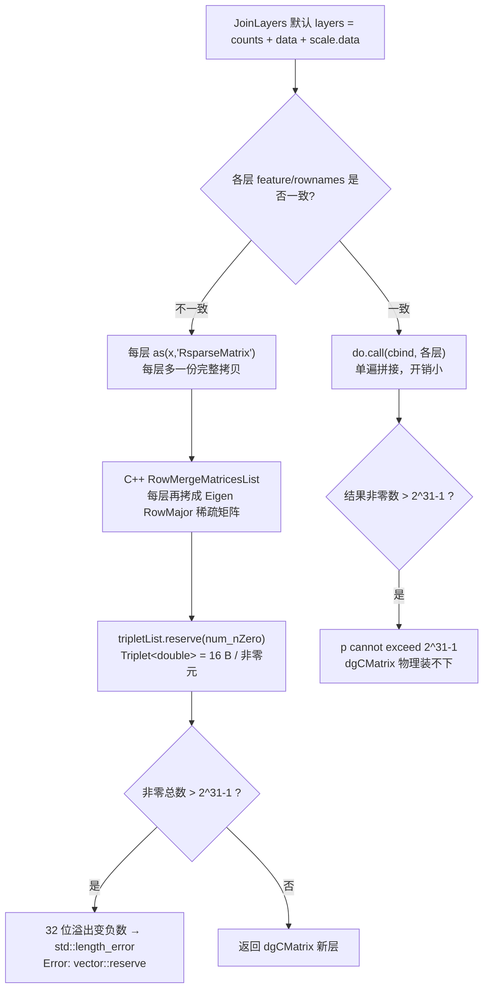

# Seurat 大对象 / layer 内存管理

处理 Seurat v5 在**大对象 + 多层**场景下的内存问题：`JoinLayers` / `merge` 爆内存或报错、
以及由此引出的降内存与落盘策略。

> 配套：单细胞分析主干流程见 `scrnaseq-seurat-core-analysis`；
> 源码级证据与完整命令见本 skill 的 `references/joinlayers-large-object-memory.md`。

## When to Use（触发场景）

- 用户报「joinlayer / JoinLayers 时占内存太大」「50 万细胞 + 320 G 内存跑不成功」；
- 报错命中判错表里任一条（见下）；
- ≥20 万细胞、对象带 `counts.1..counts.N` 多层，需要 join / merge；
- 需要给大对象降内存（磁盘层、sketch、v3 回退）；
- 用户问「内存明明够为什么跑不动」。

## 🔴 第一纪律：先要报错原文，别默认"内存不够"

**同一个函数的不同报错 = 完全不同的根因。** 尤其：

| 报错原文 | 真实含义 | 该走哪条 |
|---|---|---|
| `Error: vector::reserve`（Linux）/ `Error: vector`（macOS） | SeuratObject C++ 里 **int32 非零元计数溢出**（>2³¹），**与 RAM 无关** | B / C / D |
| `p[length(p)] cannot exceed 2^31-1`、`long vectors not supported yet` | 结果超 `dgCMatrix` 的 32 位索引上限 | 只能 D / E，加内存无效 |
| `sparse->dense coercion: allocating vector of size X GiB` + `cannot allocate vector of size Y Gb` | 被强制转稠密；或 merge 分发错了（把**矩阵**当 Seurat 对象传 → `merge.default` → `as.data.frame`，traceback 里会出现 `merge.default` 且 `add.cell.ids` 被静默忽略） | A / B |
| 进程被 OOM killer 杀掉、无 R 报错 | 真的峰值不够 | A + C + D |
| 不报错但几小时不返回 | 层数太多 / 层名异常，C++ 里逐 feature 哈希 | B / C |
| `Cannot merge matrices with different data type`（磁盘层） | 各层存储类型不一致（float vs double） | `convert_matrix_type()` 统一后重 join |

⛔ **不要用"加内存 / 换服务器"作答**：本例 320 GB 也失败，issue 里 900 GB 内存的用户同样失败。
⛔ **不要凭记忆描述库内部机制** —— 用户会追问"你看过源码吗"。机制要带 `文件:行号`（见 reference）。

**必须向用户索要的三样**：① 完整报错原文；② `sessionInfo()` + `packageVersion("Seurat")` /
`packageVersion("SeuratObject")`；③ 诊断脚本输出（见方案 0）。

## 为什么会吃这么多内存（机制摘要）



1. **默认并三类层**（`JoinLayers.StdAssay`：`layers %||% c('counts','data','scale.data')`）——
   `scale.data` 是稠密的，并它纯属浪费；`data` 可以重算。
2. **对象级调用写法是错的**：`obj[["RNA"]] <- JoinLayers(obj)` 会遍历所有 assay，
   应为 **assay 级** `obj[["RNA"]] <- JoinLayers(obj[["RNA"]])`（社区实测几秒 vs 半小时不返回）。
3. **各层基因名不一致 ⇒ 走最贵的 C++ 路径**：每层 `as(x,"RsparseMatrix")` 完整复制一份
   （部分 Matrix 版本还经稠密中转），再拷成 Eigen RowMajor，最后 `Triplet<double>` 列表 16 B/非零元。
4. **决定性一击**：非零总数累加进 `int`，过 2³¹ 变负 → `reserve()` 收到巨值 → `length_error`。
5. **即使不溢出**：`dgCMatrix` 的 `i`/`p` 是 32 位，>2³¹-1 非零元**物理上不可表示** ⇒ 必须换后端。
6. **「单核」不是限制**：`JoinLayers` 本就单线程；**多核（future）反而每个 worker 各持一份拷贝，更吃内存**。

## 方案（按推荐顺序，代码可直接粘贴）

### 0. 先量规模（30 秒，决定后面怎么走）
```r
library(Seurat); library(SeuratObject)
obj <- readRDS("xx.rds")
obj[["RNA"]]                        # feature 数 + 层数
ln  <- Layers(obj[["RNA"]], search = "counts")
nnz <- vapply(ln, function(l) length(LayerData(obj[["RNA"]], layer = l)@x), numeric(1))
sum(nnz)                            # > 2^31-1 ⇒ 任何 in-memory JoinLayers 都无解
ncol(obj); length(ln)
```

### A. 只并需要的层 + assay 级调用（最省，先试）
```r
obj[["RNA"]] <- JoinLayers(obj[["RNA"]], layers = "counts")
# data 层不要并，重算更便宜：obj <- NormalizeData(obj)
```

### B. 手工 cbind 重建 counts —— 绕开 C++ 路径（社区实测 2.6 秒）
前提：各层 rownames 一致 **且** 总非零元 < 2³¹。
```r
rna  <- obj[["RNA"]]
mats <- lapply(Layers(rna, search = "counts"), function(l) LayerData(rna, layer = l))
stopifnot(all(vapply(mats[-1], function(m)
  identical(rownames(m), rownames(mats[[1]])), logical(1))))      # 前置检查
m <- do.call(cbind, mats)[, colnames(obj), drop = FALSE]          # 按对象细胞顺序重排
obj2 <- CreateSeuratObject(counts = m, meta.data = obj@meta.data)
rm(mats, m); gc()
```

### C. 从源头不产生分层
- 建对象前 `options(Seurat.object.assay.version = "v3")`（v3 assay 无 layer）；
- 已有对象转回：`obj[["RNA"]] <- as(obj[["RNA"]], "Assay")`；
- merge **一次性**：`merge(objs[[1]], y = objs[-1])`，⛔ 不要两两 merge
  （会产生超长层名、可能引入重复细胞，放大非零元计数）。

### D. on-disk（BPCells）层 —— ⭐ 既降内存又绕开溢出 bug
SeuratObject 对磁盘层有**专门**实现 `StitchMatrix.IterableMatrix`（`rbind` + `Reduce(cbind)`，
全是惰性/磁盘操作，缺行用 `SparseEmptyMatrix` 补齐），而内存层走 `StitchMatrix.dgCMatrix`
→ `RowMergeSparseMatrices`（就是碰溢出那条）。⇒ 把 counts 换成磁盘层即可避开。
```r
library(BPCells)
write_matrix_dir(mat = obj[["RNA"]]$counts, dir = "counts_bp")     # 逐层写；层多就循环
obj[["RNA"]]$counts <- open_matrix_dir(dir = "counts_bp")
```
- 官方 1.5M 细胞示例：`CreateSeuratObject(counts = <命名好的磁盘矩阵 list>)` 一次建出多层磁盘对象；
- 保存用 **`SaveSeuratRds()`**（会同步改写磁盘路径指针；裸 `saveRDS` 不会）；
- 拿回内存：`as(layer, Class = "dgCMatrix")`；
- 磁盘层 join 报类型不一致 → 先 `convert_matrix_type(layer, "double")` 统一。

### E. 降规模再 join
`SketchData()`（LeverageScore 抽样、保留稀有群）后在 sketch 子集上 join；或先 subset 再 join。
官方 1.3M / 1M 细胞 vignette 即此路。

### F.（应急，不推荐）装未合并的修复分支
seurat-object PR #320（**draft**）含 int32→int64 修复 + 更清晰报错 + 磁盘层 join/save/reload。
装了它报错会变明确，但 **>2³¹ 非零元的 dgCMatrix 依然造不出来**（PR 自己写明）⇒ 最终仍走 D/E。

## Pitfalls

| 现象 | 原因 / 处理 |
|---|---|
| 用户说"内存够但跑不动"，直接答"内存不足/加内存" | 大概率是 int32 溢出 bug，与内存无关 → **先要报错原文** |
| 用 `joinLayers(obj)`（小写 l） | 无此函数；`JoinLayers` 大小写敏感，报错会误导向"对象损坏" |
| 断言"升级 Seurat 就好了" | 必须核三点（main 源码 / PR 状态 / 已发布版本）；**draft PR ≠ 已修**，本例已发布版本仍带 bug |
| 手工 cbind 前没检查各层 rownames | 层间 feature 不一致时 `cbind` 语义错误（会按位置拼基因）→ 必须 `stopifnot(identical(rownames(...)))` |
| `LayerData()` 在磁盘层上取值 | 会把磁盘层**载入内存**（可能直接爆）→ 对象已是 BPCells 时改用 `Matrix::nnz` 类接口 |
| 把矩阵而不是 Seurat 对象传进 `merge()` | 走 `merge.default` → `as.data.frame` → 稀疏转稠密，几百 GB（traceback 有 `merge.default` 即为证） |
| 认为"多开核能加速 JoinLayers" | 它单线程；多核经 future 会**成倍复制对象** |

## References

- `references/joinlayers-large-object-memory.md` — **完整源码级记录（2026-10-24 核实）**：
  逐条机制与 `文件:行号`（`R/assay5.R:1059-1097`、`R/utils.R:1565-1593`、`R/utils.R:2218-2300`、
  `src/data_manipulation.cpp:12/79/93/98`）、500k 细胞量级校验（为什么"320 GB 不够"反常）、
  判错表全量、方案 A–F 完整代码与适用前提、「修复了没有」三点核验命令与实测结论
  （main 仍 `int num_nZero`、PR #320 draft、CRAN SeuratObject 5.4.0）、交付口径与被接受的回复形状、来源链接。
- 相关：`scrnaseq-seurat-core-analysis`（主干流程）、`stratified-subsampling`（降采样/抽样口径）、
  `error-recovery`（报错诊断通用流程）。