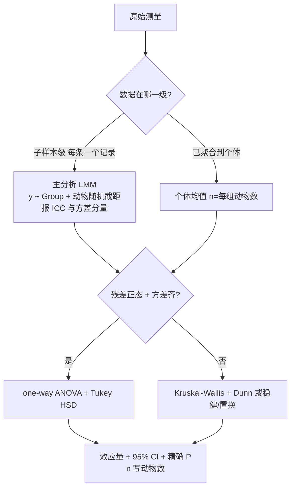

# 统计方案审查（Statistical Design Review）

审查**已提出**的统计方案（不是帮用户设计新实验），产出 = 严重度分级的问题清单 + 可落地的正确做法 + 复核证据。
上游设计与功效规划见 `experimental-design-statistics`；统计报告口径与失败模式分类见 `nature-statistics`
（本 skill 与它们互补：它们讲"怎么设计 / 怎么写方法学"，本 skill 讲"**怎么审一份已成型的方案并给出修正**"）。

## 何时用 / 何时不用

- ✅ 用户话里同时有**设计**（组数、每组 n、测量层级）+ **统计方法**（t 检验/Pearson/ANOVA…），并要求审/挑错/给正确做法。
- ✅ 只给了方法没给数据 → **照样能审**（本 skill 用模拟数据演示偏差，不依赖用户数据）。
- ❌ 只是问某个检验的定义（走 knowledge 查询）。
- ❌ 用户给了数据要"帮我跑分析"（走对应分析 skill，不适用本流程）。

## 🔴 核心手法：用模拟数据把偏差跑出来（本 skill 的命门）

**不要只断言"这样会有伪重复、p 值会虚小"**——按用户的设计造一份模拟数据，把**错误口径与正确口径的 p 值并排**给出来。
这一步把"我认为"变成"跑出来就是这样"，是这类审查唯一有说服力的证据；也是后续 rail_review(post) 的图来源。

一个脚本做完（避免多轮往返）：按真实设计造数（组数 × 每组动物数 × 每只子样本数，组间效应取小/中 `d≈0.5`）→
① 错误口径（子样本当 n，未校正两两 t）② 个体均值 + ANOVA + Tukey ③ LMM + ICC ④ 功效表 → 打印对照表。

**可直接引用的实测数字（2026-09-25，小鼠 3 组×6 只×16 根纤维/只，真实效应 d=0.5）**：

| 口径 | A-C / B-C 的 P | 判定 |
|---|---|---|
| 纤维当 n=288，两两 t 检验 | 3.7e-05 / 1.6e-03 | ✗ 虚假显著 |
| 每只小鼠均值（n=6/组）+ ANOVA + Tukey | 0.174 / 0.457（p adj）| ✓ |
| LMM `y ~ Group + (1\|Mouse)` | 0.077（C vs A），**ICC=0.289** | ✓ 推荐 |

话术：**"同一批数据，原方案报出 P<0.001，正确做法是阴性"**；ICC≈0.29 = 个体间方差占近 1/3 ⇒ 子样本不独立的量化证据。
功效（n=6/组，α=0.05）：d=0.5 → **0.12**；0.8 → 0.24；1.2 → 0.47；1.5 → 0.65；3 组 ANOVA → **0.27**。

> ⚠️ 上表数字**绑定当时脚本参数**（`set.seed(42)`、3 组×6 只×**16 根/只**、d=0.5）。改了根数/效应量就变
> （旧版记的 ICC=0.313 / p=0.091 即另一组参数所致）。**引用前先回看当次脚本参数与实际输出，不要照抄本表。**

现成探针：`scripts/stats_plan_audit_demo.R`（改开头参数即可套用到任何"多层测量 + 多组比较"设计）。

## 输出骨架（照此组织，别写成散文）

1. **一句话结论 + 严重度标签**（"方向对，但有两处 P0 会被审稿人打回"）。
2. **逐条问题表**：`级别 | 问题 | 为什么错 | 后果`。
3. **实测证据**（上节的对照表 —— 数字优先）。
4. **正确做法**：比较类 / 相关类 / 样本量与可复现分块给，配检验选择流程。
5. **可复用代码**：能直接粘的 R 片段；缺包给安装命令但**不擅自安装**（铁律 29）。
6. **待补信息 AUTHOR_INPUT_NEEDED**：只列**会改变下一步动作**的问题（测量层级、是否配对、协变量、细胞数）。
7. **参考来源**：KB/技能 + ≥2 篇带 PMID/DOI 的文献 + 本次模拟复现的脚本/图路径。

## 五大红旗（P0/P1 速查，带判据）

| 级别 | 红旗 | 判据 / 要说清什么 |
|---|---|---|
| **P0** | **分析单位错位（伪重复）**：纤维/细胞/视野/孔/读数都不是独立实验单位 | 动物/供体才是 n；报 **ICC 或方差分量**作证据 |
| **P0** | **多组两两 t 检验未校正** | k 次比较 FWER = `1-(1-α)^k`；3 次 = **14.3%** → ANOVA + Tukey/Dunnett 或明确预指定比较族 |
| **P1** | **比例/组成数据直接 Pearson** | 受限 [0,1] + 和恒为 1 + 二项抽样误差 + 常非正态 → logit/CLR/ILR 变换或 beta 回归 |
| **P1** | **相关分析忽略分组** | 多组合并画一条线 = 组间均值差被读成"相关"（Simpson 悖论）→ 偏相关 / 分组散点 / Group 入模 |
| **P1** | **小样本无功效说明** | 给 MDE（最小可检测效应）；`n=6/组` 只能检出大效应 |
| **P2** | 只报 P 无效应量/CI；比较族未定义；配对/区组不明；技术重复当独立点；体重等协变量未纳入 | 报告 = 效应量 + 95% CI + 精确 P + **n 的定义（一律写动物数）** |
| **P1** | **配对与独立效应量混排、共用同一色标/共轴** | `d_z` 的分母 `sd(post−pre)` 含组内相关 r ⇒ 与独立 Hedges' `g` 不同尺度、跨面板不可比（同一张图里颜色深浅差混进了 r 而非生物学）；⛔ 换算 `d_av = d_z·√(2(1−r))` 仅在 s_pre≈s_post 时成立（实测逐格偏差可达 2.09）→ 配对端一律报 `d_av = mean(diff)/√[(s_pre²+s_post²)/2]`（**不含 r**），`d_z` 只作敏感性分析。⚠️ 偏差方向随 r 变：r=0.8 时 `d_z` 虚高 58%，r 低/为负时反而缩小（实测某队列 r 中位 0.322、32% 格 r<0 ⇒ 缩到 0.65 倍） |

配套：**相关 ≠ 因果**（措辞限"关联"）；**技术重复先平均**；**有序因素（剂量/年龄梯度）用趋势检验**（线性趋势 / Jonckheere-Terpstra）而非两两比较。

## 正确做法

### 比较类（多层测量的多组比较）


> mermaid 节点文字里**不要写竖线**（会破坏解析）——随机截距写"动物随机截距"而不是 `(1|Animal)`。

- 主分析 LMM，**同时给一个不依赖 LMM 的敏感性分析**（个体均值 + ANOVA + Tukey 或 Kruskal-Wallis + Dunn）；两法一致才下结论。
- 子样本按类型分层（如纤维类型 I/IIa/IIx）→ 类型进固定效应：`y ~ Group*FiberType + (1|Animal)`。

### 相关类（有界变量 vs 连续表型）

1. **单位对齐**：每个个体一个配对点；表型重复测量先取均值；**细胞数决定比例精度，不能当 n**。
2. **变换**：logit / CLR / ILR；出现 0/1 → 零替换（如 +0.5）或 beta 回归。
3. **主分析**：Spearman（对单调非线性/离群稳健）+ Pearson 作敏感性；比例在 (0,1) 且要建模方差 → beta 回归。
4. **控制分组**：偏相关（残差法即可，零依赖）或 Group 入模；各组截距不同时优先"分组散点 + 组内/偏相关"，**不要合并成一条总体相关线**。
5. **多重比较**：多个细胞类型 → BH-FDR。
6. **报告**：r 或 ρ + 95% CI + n + 精确 P + 分层散点图。

### 样本量与可复现
n 太小且无法加动物 → 方法里写功效/MDE，结论降级为探索性；**投稿前冻结统计分析计划（SAP）**（主模型/校正/变换/离群规则事先写死，防事后试到显著）。

## 小样本两组比较的执行口径（n ≤ 10/组，独立两组）

**触发**：用户给了小表（几个基因/指标 × 每组 5–10 例）要「两组比较 + p + 效应量 + q」，且**表头/列名由用户指定**。
先定口径再写代码；四项（检验名、效应量定义、校正方法、flag 判据）都要落进产物和回复。
现成实现：`scripts/two_group_compare.py`（零依赖 `--selftest` 自证）；本次实测数字见
`references/small-n-two-group-comparison.md`。

### 1) 检验选择（按数据结构，不按口味）

| 数据结构 | 主检验 | 说明 |
|---|---|---|
| 独立两组、方差不齐风险 | **Welch 双侧 t**（不等方差） | **默认**。n=6 时既查不了方差齐性也查不了正态性，Student 的合并方差只会高估精度 |
| 同一供体 Pre/Post（真配对） | 配对 t / Wilcoxon signed-rank | 效应量换 `d_av`（见上方 P1 红旗，禁 `d_z` 作主口径） |
| 有序梯度（剂量/年龄档） | 趋势检验 | 不要退化成两两比较 |
| 明显非正态 + n 相同 | Mann-Whitney U | p 常与 t 检验同量级；别为"更保守"无脑换 |

⚠️ **样本命名 `A_1..6 / B_1..6` 不构成配对证据**：编号相同可能只是列表顺序。判定配对看是否同一供体/同一批次，
拿不准就**问一句**（`ask_user`），并给「若按配对算结果怎么变」的敏感性分析。

### 2) 效应量：Hedges' g（小样本必校正）

```
d = (m1 − m2) / SD_pooled      SD_pooled = √[((n1−1)s1² + (n2−1)s2²) / df]
g = d · J                      J = 1 − 3/(4·df − 1)      df = n1 + n2 − 2
```
n=6/组 → df=10 → **J = 0.9231**（不校正会系统性虚高）。

🔴 **等样本量时 `SD_pooled` 与 Welch 分母同式** `√[(s1²+s2²)/2]` ⇒ **Welch + Hedges' g 不冲突**；
**n 不等时才必须声明**用哪种（Welch d 用非合并 SD，与 g 不同尺度，不可混排共轴）。

自证算式（本次实测）：GENE1 `d = 2.14117 / 0.71146 = 3.0093`，`g = 3.0093 × 0.9231 = 2.7777` ✔ 与产物一致。

### 3) 多重检验：BH-FDR，按面板内/检验族校正

基因数再少（m<10）也要校正：m=6、最小 p=3.9e-4 → q=2.4e-3；**边界基因最容易翻案**（见下）。
BH 要带单调化（`q_i = min(prev, p_(i)·m/i)`，从最大 p 往小累进），否则会出现 q 倒挂。

### 4) 🔴 固定表头同时含 `pvalue` + `qvalue` + `differential` 时：flag 判据必须自曝

用户指定的表头同时要原始 p、校正 q 和 yes/no 判定列 ⇒ **判据选择会改变结论，必须写明**：

- flag 用 `p < 0.05` 还是 `q < 0.05`？**在回复里明确声明**（本次按 raw p 标，并点明"若以 q<0.05 为准则只剩 1 个"）。
- **主动点出边界行**（`p < 0.05` 但 `q ≥ 0.05`）——本次 GENE3 `p=0.0271 / q=0.0813`。
  不说 = 用户自己发现产物自相矛盾（交付缺陷）；说到 = 严谨性加分项。
- ⛔ 不要把 p 和 q 填成同一个数（那等于没校正）；也不要只给 q 不给 p。
- 列名写不下判据时，把判据写进回复 + 备注列/notes，别默默决定。

### 5) 小样本局限清单（回复里必写，4 条起）

1. n=6/组功效低：`d=0.5→0.12、0.8→0.24、1.2→0.47、1.5→0.65`（α=0.05）——**不显著 ≠ 无差异**，缺的是功效不是效应。
2. 正态性/方差齐性在 n=6 下几乎无法检验 ⇒ 前提只能写"未发现明显违背"。
3. 配对结构不明（见 1 节）；未校正性别/年龄/批次等协变量。
4. 数据若形似合成/演示数据（基因名 `GENE1..N`、数值整齐、样本名 `A_1..6`）→ **如实说"疑似模拟数据"**，
   不要把演示产物当生物学结论；同时**不做**任何额外分析（用户只要口径说明时）。

## 小样本表「有缺陷」时怎么算：结构缺陷分诊 → 结论分级（2026-10-18 实测）

**触发**：用户给的小样本表**不是干净数据**——文件名带 `flawed/clean/v2`、某组内出现大间隙或离群点、或你上一轮说过"干净"；
用户要「**哪些真有差异、结论有多可靠**」。完整实测数字与三情景模拟见 `references/small-n-two-group-structural-flaws.md`。

### 铁律：先判结构，再选检验；naive p 只在功效够时才算证据

先算 **MDES**（非中心 t 精确解，`scipy.stats.nct` 二分），再看实测 |g|：

| n/组（α=0.05, power=0.80） | MDES(\|Hedges g\|) |
|---|---|
| **6** | **1.796** |
| 8 | 1.52 |
| 10 | 1.34 |
| 12 | 1.21 |

实测 |g| ≪ MDES ⇒ **p>0.05 是"功效不足"，不是"无差异"**；写成阴性 = 无效结论。
阴性结论的**双条件**：功效 ≥0.80 **且** CI 上界 < MDES。
🔴 功效不足最常见的成因**不是 n 小，而是结构缺陷把噪声抬高**——本例组内 SD 从层内 0.085 虚高到 1.570，功效从 >0.99 掉到 **0.198**。

### 三类缺陷的检测与边界

| 缺陷 | 检测方法 | 🔴 陷阱 | 能下 / 不能下 |
|---|---|---|---|
| **组内双峰（层/批次/亚结构）** | **间隙法**：`max(组内相邻差) / 层内 SD`；>5 即层结构（实测 2.9/0.085 = **34 倍**） | **Grubbs 对对称双峰结构性失明**：两端对称偏离把 SD 抬高，单点标准化偏差反而变小（实测 G=**1.321** < 临界 **1.887**，判"无离群"） | ✅ naive p 不可作阴性；⛔ 事后分层不可当确认阳性 |
| **单点离群** | Grubbs G > 临界（n=6→1.887）；IQR | 离群点若**恰落在另一组区间内** ⇒ 先疑标签错标，不要当"高反应者" | ✅ 组间方向（见三情景）；⛔ 另一组的"生物学异质性/个体差异大" |
| **组内重复值** | 先算**期望重复对数** `res·n(n−1)/(4√π·s)` | 直接当缺陷是误判 | 实测期望 **1.30** 对 vs 实测 1 对 ⇒ 在随机期望内，**不算缺陷** |

### 单点离群不要二选一 —— 跑三情景（本次实测）

| 情景 | n | diff | p | g |
|---|---|---|---|---|
| 保持原点（真高反应者） | 6v6 | 2.458 | 4.3e-3 | 2.62 |
| 剔除（QC 不合格） | 5v6 | 2.957 | ~1e-10 | 28.6 |
| 标签错误（归入另一组） | 5v7 | 2.961 | ~1e-10 | 30.3 |

三方向一致 ⇒ **方向结论稳健、不依赖该点归属**；但机制解读仍不可下。
（注：离群点让差异被**低估**，剔除后更强 ⇒ "剔除后更强"能证方向稳健，不能证原结论。）

### 敏感性三件套（每次都要给全）

`naive` Welch / **分层 OLS**（结构指示变量入模取公共组效应）/ **留一法 jackknife 最不利 p**（逐一剔除样本取**最大** p）。
分层必须再给 `group:layer` **交互项**：交互≈0 且两层效应相同 ⇒ 效应层内一致（实测交互 coef=**−0.0000**、p=**1.000**，两层均 1.2000）。

### 结论分级三档（写进产物表，别只写散文）

| 档 | criteria | 本次 |
|---|---|---|
| `confirmatory_supported` | 所有敏感性一致显著 **且** 结构审计全过（Grubbs/Shapiro/极差÷SD/重复值期望） | GENEDUP |
| `directional_conditional` | 方向稳健（多情景一致），但机制/异质性解读不可下 | GENEMIS |
| `naive_negative_invalid + exploratory` | naive 阴性无效（功效不足）；正面证据仅探索、不可外报 | GENEBATCH |

### 报告七件套（缺一即不合格）

naive p / **MDES** / **power** / 效应量 + 95%CI / 留一最不利 p / 分层前后 p / 结构审计（组内间隙、Grubbs、Shapiro、重复值期望）。

### 🔴 交付格式（用户偏好，2026-10-18）

- 每条"**能下**"的结论必须**并排**给出"**不能下 + 原因**"。用户原话是"哪些真有差异、**哪条结论不能下、为什么**"——只报阳性发现 = 没答完。
- 说某基因/样本"**干净/无异常**"时，**当轮就把两组原始值逐条列出**并附量化判据（极差÷SD vs n=6 正态期望 **2.534**、Grubbs vs 临界、Shapiro p、重复值 vs 期望对数）。用户会追问"再确认一次原始数值有没有异常"——一次说全，别让人问第二遍。
- 文献检索若未命中对口证据（本次两轮 `search_papers` 均返回不相关论文）⇒ "是批次结构""是错标"这类归因**必须标注为推断而非文献支持**，不得虚构引证。

### 平台机制（本次踩到）

- 裁决 `next_actions` 中 `owner=ai` 的条目**必须真执行**，并在 `todo` 里把对应项（id 形如 `debate_todo_<n>_<i>`）标 `status='completed'`；否则 `save_knowledge` / `generate_report` 等入库类工具被硬拦：`⛔ 辩论裁决的硬约束还没满足…`。
- `record_run(script_name=...)` 里的脚本名**必须真实落盘**——先 `write_file` 写脚本再 record_run，否则运行记录指向不存在的文件。
- 辩论场景 = `stats_design`；本次 L2 裁决 = **modify / medium**，rubrics 扣分集中在 `design_validity=5`（缺元数据）。

## 可复用 R 代码（2026-09-25 实测跑通）

```r
library(lme4); library(lmerTest)                        # 主分析
m <- lmer(CSA ~ Group + (1 | Mouse), data = fiber)
car::Anova(m); VarCorr(m)                               # 组间主效应 + 方差分量/ICC
emmeans::emmeans(m, pairwise ~ Group, adjust = "tukey") # 未装 → 先问用户再装

# 敏感性分析：不依赖 LMM。⚠️ 按分组聚合用 tapply，不要 aggregate（字符型分组列报 non-numeric-alike）
mu  <- tapply(fiber$CSA, fiber$Mouse, mean)
grp <- tapply(as.character(fiber$Group), fiber$Mouse, function(x) x[1])
agg <- data.frame(Mouse = names(mu), Group = factor(grp), CSA = as.numeric(mu))
TukeyHSD(aov(CSA ~ Group, data = agg))
rstatix::kruskal_test(CSA ~ Group, data = agg)          # 非正态备选

# 比例 - 表型（每个体一个点）
d$lg <- qlogis(pmin(pmax(d$prop, 1e-3), 1 - 1e-3))      # logit 变换
cor.test(d$lg, d$grip, method = "spearman")             # 稳健主分析
rx <- resid(lm(prop ~ Group, d)); ry <- resid(lm(grip ~ Group, d))
cor.test(rx, ry)                                        # 偏相关（残差法，替代 ppcor，零依赖）

power.t.test(n = 6, delta = 0.5, sd = 1)$power          # 0.12
```

依赖现状（本机实测）：`lme4 / lmerTest / rstatix / car` 已装；`emmeans / betareg / ppcor` **未装** →
偏相关用残差法替代 ppcor；emmeans/betareg 给安装命令但先征得用户同意。
执行：脚本落盘后 `source('<abs path>', encoding='utf-8')`（`exec(open(...).read())` 是 Python 配方，R 没有 exec）。

## 诊断图（统计审查也该出图，且这是过 rail_review(post) 的正解）

rail_review(post) 对无图脚本硬判 failed（`未生成任何图片`）。**正解不是凑占位图，而是出一张真实诊断面板**（本身就是交付内容）：
四联图（`par(mfrow=c(2,2))`，base graphics，零依赖）= A 伪重复代价（`-log10(P)` 双色柱 + 0.05 阈值线）/ B 嵌套结构（逐动物箱线 + 动物均值点）/
C 功效缺口（power vs n 三条线 + n=6 标注）/ D 比例-表型散点（按组着色 + 三口径相关值）。

🔴 **中文标签在 R 里能出**：`png(f, width=2600, height=2100, res=200, type="cairo")` + `par(family="Microsoft YaHei")`
（实测：中文正常、无 `mbcsToSbcs` 警告、文件正常落盘）。**先试这一行，别默认切 Python。**

## 平台集成（实测口径）

- **辩论场景 = `stats_design`**：topic/context 写清"统计设计审查 + 单位/多重比较/比例方法/功效/预注册"，裁判即用
  「实验单位判定 / 伪重复控制 / 多重比较校正 / 效应量与区间 / 相关有效性 / 功效论证 / 预注册」rubric；传 `statistics_kb` 注入更有效。
- ⚠️ **L1 辩论角色可能只回 reasoning 草稿**（`pro_draft_only/con_draft_only: true`）⇒ 引用裁决时**如实说明"正反方未按契约输出，
  裁判依据上下文数据与规则裁决"**并按中等置信处理；不要包装成满血 L2，也不要编造辩论轮次。
- 裁决的 `missing` = 交付里要写的"待补证据"清单。
- 纯审查回合不建 task_plan、不跑分析管线；但**模拟演示脚本与诊断图要落盘**并给出绝对路径。
- **重跑同类审查先复用旧脚本，不要重写第二份**（2026-09-25 实测）：`search_files(pattern="stats_review*", target="files")`
  找到上一会话产物 → 复制到**当前** `results/<sid>/scripts/`（只改 `out_dir` 和本次要调的参数，绝不覆写旧会话目录）
  → `execute_r(source("<abs path>", encoding = "utf-8"))` 跑通 → 先核对打印的个体数/纤维数 → 出图
  → rail_review(post)（`output_dir` 传当次会话根）= passed、`figure_count=1`。
- 交付里的每个数字必须来自**当次实际输出**；旧案例文件/本 SKILL.md 的数字只是参考，参数一改就变。

## Pitfalls

- ⛔ **别把审查扩成"顺手帮你重跑全套分析"**——用户没给数据时，模拟数据只用于**演示偏差**，报告里明说"数据为模拟、仅验证统计流程"。
- ⛔ **别替用户假定设计细节**（每只几条腿/是否左右配对/有无协变量/细胞总数）→ 全部进 `AUTHOR_INPUT_NEEDED`。
- ⛔ 别把"不显著"写成"无差异"、把关联写成因果、把效应量大写成"显著"。
  🔴 硬化版（2026-10-18）：**naive p 只在功效 ≥0.80 时才有资格作阴性证据**；实测 |g| ≪ MDES 时 p 大是功效问题。报阴性必须同时给 **MDES + power + CI 上界 < MDES**。
- ⛔ **不要用 Grubbs 判"有没有组内结构"**（2026-10-18 实测）：Grubbs 对**对称双峰结构性失明**（实测 G=1.321 < 临界 1.887 却明显双峰，因为两端对称偏离把 SD 抬高）。组内层/批次结构必须用**间隙法**（`max(组内相邻差)/层内 SD`，>5 即层）。反过来也不要用间隙法否证离群点——两者各管一类。
- ⛔ **组内重复值不要直接当数据缺陷**：先算期望重复对数 `res·n(n−1)/(4√π·s)`（分辨率 0.05 / s=0.163 / n=6 → 期望 1.30 对，实测 1 对即在期望内）。
- ⛔ 说数据"干净"却不出示原始值 = 会被用户追问（2026-10-18 原话"再确认一次它两组各有 6 个样本的原始数值有没有异常"）。**当轮列全原始值 + 量化判据**。
- ⛔ `aggregate()` 遇字符型分组列报 `non-numeric-alike`（stdout 全丢）→ 按分组聚合一律 `tapply`。
- ⚠️ 缺包（emmeans/betareg/ppcor）先查用户环境、问过再装，装到项目内库（铁律 29）。
- ⚠️ **模拟数据里个体 ID 必须由「组别」生成，不能由「只序」生成**（2026-09-25 实测踩到）：
  `sprintf("%s%02d", c("A","B","C")[m], m)` 会让 18 只小鼠重名成 6 只 → `tapply(..., Mouse, mean)`
  把跨组纤维并成一只，Tukey/箱线全部失真。信号：`boxplot(CSA ~ Mouse)` 只画出 6 个箱子、
  或 `length(unique(d$Mouse)) != n_group * n_mouse`。**跑完先打印个体数核对**：
  `cat(length(unique(d$Mouse)), nrow(d))` 应为 `18` 与 `288`。
- ⚠️ **数字脚本与图脚本必须共用同一 `set.seed` + 同一套参数**（2026-09-25 复现时踩到）：两份模拟分开写，
  极易一份 `n_fiber=20`、另一份 `n_fiber=16` → 报告里的 p 值表与诊断图**互相矛盾**（本次已统一为 16 根/只）。
  同理**图例/文字里的 n 要随参数走**：旧版图例写"纤维当 n=96"而实际已是 288，属自相矛盾的证据，改参数后必须同步图例。
- ⚠️ **出图后核验非空白**：`vision_describe(图路径)` 应能 OCR 出四个面板标题与关键数值
  （本次读到"A 伪重复的代价 / B 嵌套结构 / C 功效缺口 / D 比例-表型"与 `d=0.5 时 power = 0.12`）。
  读不到标题 = 字体或空白问题，先修再交付。

## 配套文件

- `references/small-n-two-group-structural-flaws.md` — **有缺陷数据**的小样本两组比较完整案例（2026-10-18，`expr_flawed.csv` 3 基因×6v6）：三类结构缺陷的检测与边界、Grubbs 双峰失明实测、MDES 表、离群点三情景模拟、期望重复对数公式、"干净"的完整量化判据、结论分级三档、七件套报告模板、辩论裁决与 missing 清单。
- `references/mouse-fiber-csa-review-2026-09.md` — 小鼠肌纤维 CSA 方案审查完整案例：实测数字、脚本清单、四联图配方、文献锚点（Aarts 2014 / McKinnon Reish 2024 / Zhang 2024）、辩论裁决与 missing 落地。
- `scripts/stats_plan_audit_demo.R` — 可直接复跑的审查探针：模拟多层设计 → 三口径 p 值对照 + ICC + 功效表 + 四联诊断图（改开头参数即可套用其它设计）。
- 相关 skill：`experimental-design-statistics`（设计/功效规划）、`nature-statistics`（统计报告与失败模式分类）、`platform-execution-pitfalls`（执行层坑）。

## 参考来源

- Aarts et al. 2014, *Nat Neurosci*, DOI 10.1038/nn.3648（PMID 24671065）— 嵌套数据应做多水平分析。
- McKinnon Reish et al. 2024, *Appl Environ Microbiol*, DOI 10.1128/aem.01033-24（PMID 39082810）— 伪重复的常见形态。
- Zhang et al. 2024, *Comput Struct Biotechnol J*, DOI 10.1016/j.csbj.2024.11.003（PMID 39624165）— 比例/组成数据变换。
- skill `nature-statistics` → `references/common-failure-modes.md`（P0 伪重复 / 未校正多重比较 / 分析单位不匹配）。

## Proven Scripts

> Auto-generated from actual analysis runs. Each row records a successful execution.

| 物种 | 组织 | 方向 | 日期 | 脚本 | auto | user | ✔ |
|------|------|------|------|------|------|------|----|
| mouse | skeletal_muscle | statistical_review | 2026-09-25 | stats_review_demo_pseudoreplication.R | - | - |  |
| human | skeletal_muscle | aging | 2026-10-18 | expr_outlier_stats.py | - | - |  |
